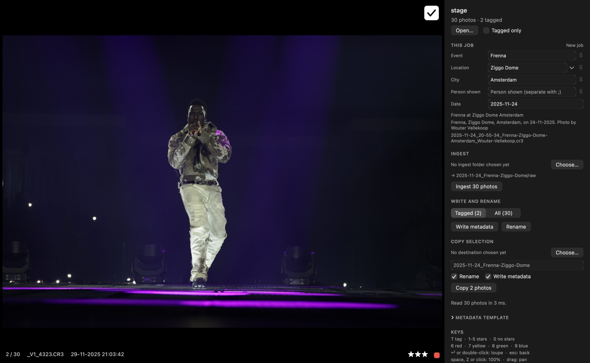
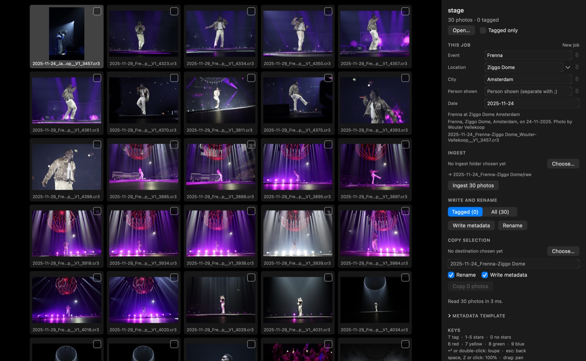

# Pitpick

**Fast culling, IPTC metadata and renaming for photographers on macOS. Nothing else.**

Free and open source. Named after the photo pit, made for picking fast. Formerly called Snelkeus.



## Why

I'm a concert photographer and shoot with two Canon EOS R5 Mark II bodies. After a show I need to get from two full cards to a captioned, well-named selection, and I need it fast.

Photo Mechanic is fast because it never renders the raw: it shows the JPEG the camera already embedded in every file. Pitpick does the same, and only the few things I actually use: ingest, cull, caption, rename, copy. No catalog, no editing, no subscription.

## What it does

- **Fast.** Pitpick never develops a raw.
  - For Canon CR3 it reads the camera's full-size embedded JPEG (8192x5464 on an R5 II) straight out of the file.
  - On a Mac mini M4 Pro, with real concert files:
    - a photo at screen size takes about 35-50 ms
    - a 100% focus check takes about 85 ms
    - a grid thumbnail takes 3-6 ms
  - It preloads in the direction you browse. In tests at 8 photos per second every frame was already sharp when it appeared; at 15 per second, 31 of 33 were.
- **Ingest.** Put both cards in, drag them onto the window and fill in the job.
  - Everything is copied to `<ingest folder>/<job folder>/raw`, with folder and file names built from your metadata.
  - Both cards copy at the same time, each from its own reader, like Photo Mechanic. The XMP is written alongside, so the ingest runs at the speed of your card readers.
  - You can start culling while it is still copying. Photos appear in shooting order.
  - Run it again and it continues where it stopped. Nothing is copied twice.
  - If two files would get the same name, the second one gets `-2`.
- **Names that sort.** By default every file is named after the moment it was taken, the job and the photographer:
  `2026-11-19_21-04-37_Event-Location-City_Your-Name.CR3`
  - The date and time come from the camera, so the files of both bodies sort in shooting order.
  - Frames shot in the same second get `-2`, `-3`.
  - Spaces become dashes ("Ziggo Dome" becomes "Ziggo-Dome"). You can turn that off.
  - Fill in the **Photographer** field once, under **Metadata template** at the bottom of the panel. It stays for every job. If it is empty, Pitpick says so before it names anything.
- **Cull.**
  - `T` tags. It is the same XMP tag Photo Mechanic uses, so the two apps read each other's tags.
  - `1`-`5` set stars and `6`-`9` set colour labels, Lightroom style.
  - Return opens the loupe. Space, `Z` or a click shows 100%.
  - `⌘T` shows only the tagged photos.
  - Photos from both bodies are merged in capture-time order.
- **Open metadata.**
  - Every common IPTC field is there: event, location, city, person shown, headline, caption, keywords, photographer, credit, copyright, usage terms and more.
  - Any field can use tokens such as `{event}`, `{location}`, `{shootdate}` or the name of another field.
  - **Pin** the fields that stay the same for every job. Unpinned fields start empty for each new job.
  - Locations remember their city.
  - Save the whole setup as a `.pitpick` preset and double-click it on another Mac. Older `.snelkeus` presets still load.
- **Rename** with a template, and undo it if needed. **Copy the selection** to an archive folder with new names and metadata.
- **Safe.**
  - Pitpick writes only XMP: a sidecar next to a raw, and inside the file for JPG, DNG and HEIC.
  - It never modifies a raw, never overwrites a file and never deletes anything.
  - Folders you mark as read-only (for example an archive drive) are view and copy only.
- **Lightroom friendly.** Lightroom Classic reads the stars, colour labels and IPTC fields when you import. Rename before you import.



## Keys

| Key | Action |
| --- | --- |
| `T` | Tag / untag |
| `1`-`5`, `0` | Stars, no stars |
| `6` `7` `8` `9` | Red, yellow, green, blue label |
| `←` `→` (`↑` `↓` in the grid) | Browse |
| Return or double-click | Loupe, and back |
| Space, `Z` or click | 100% at the mouse, drag to pan |
| Esc | Out of 100%, back to the grid |
| `⌘T` | Tagged only |
| `⌘+` `⌘-` | Thumbnail size |
| Tab | Show or hide the panel |

## Tokens

Use them in any metadata field, the file name and the folder name.

| Token | Value |
| --- | --- |
| `{event}`, `{location}`, `{city}`, `{photographer}`, ... | Any field, by its name. `{photographer}` is the IPTC Creator field (`{creator}` works too) |
| `{shootdate}` | The day the photo was taken, from the camera: `2026-11-19` |
| `{time}` | The time the photo was taken, from the camera: `21-04-37` |
| `{date}` | Job date, `2026-11-19`: one date for the whole job (the first capture day, editable), also after midnight. Meant for folder names |
| `{date-dmy}`, `{year}`, `{month}`, `{day}` | The job date as `19-11-2026`, `2026`, `11`, `19` |
| `{frame}` | Frame number from the camera file name (`3777` from `_MG_3777.CR3`) |
| `{filename}` | Original camera file name without extension |
| `{seq}` | Sequence number in the selection, `0001` |

The default file name is `{shootdate}_{time}_{event}-{location}-{city}_{photographer}` and the default folder name is `{date}_{event}-{location}`.

## Formats

Canon CR3 uses the fast path. Other raws (CR2, NEF, ARW, RAF, ORF, RW2, DNG, ...) and JPG, HEIC and TIFF work through macOS ImageIO, using the embedded previews where the camera provides them.

## Install

**From Terminal**, in one line. Installed this way, macOS doesn't ask for the "Open Anyway" step:

```sh
curl -fsSL https://github.com/woutervellekooppixel/pitpick/releases/latest/download/Pitpick.zip -o /tmp/Pitpick.zip && ditto -x -k /tmp/Pitpick.zip /Applications && open /Applications/Pitpick.app
```

**Or by hand:**

1. Download `Pitpick.zip` from [Releases](../../releases/latest), unzip it and move `Pitpick.app` to Applications.
2. The app is not notarized by Apple. The first time you open it, macOS blocks it: open System Settings > Privacy & Security and click **Open Anyway**.

You need macOS 14 or later, on Apple Silicon or Intel. ExifTool is included.

Coming from Snelkeus? Pitpick takes over its settings and rename history on the first start.

## Build from source

You need Xcode's Command Line Tools (no full Xcode), plus exiftool from Homebrew to bundle it.

```sh
brew install exiftool
./build.sh            # universal app in build/, zip in dist/
./build.sh quick      # Apple Silicon only, faster
```

Self test, run on copies of your own files in a temporary folder:

```sh
build/Pitpick.app/Contents/MacOS/Pitpick --selftest /path/to/folder/with/CR3s
build/Pitpick.app/Contents/MacOS/Pitpick --bench /path/to/folder
build/Pitpick.app/Contents/MacOS/Pitpick --bench-ingest /tmp/ingest-test /Volumes/CARD1 /Volumes/CARD2
```

## All Access

Part of [All Access](https://www.wouter.photo/tools), free tools for photographers by Wouter Vellekoop:

- [Pitpick](https://github.com/woutervellekooppixel/pitpick): fast culling, IPTC metadata and renaming for macOS
- [Bootleg](https://github.com/woutervellekooppixel/bootleg): finds where your photos turn up online
- [Stage Fix](https://github.com/woutervellekooppixel/stage-fix): Lightroom presets for stage light
- [Crop & Roll Export](https://github.com/woutervellekooppixel/lightroom-plugins): Lightroom Classic exports sorted by aspect ratio
- [Remix](https://github.com/woutervellekooppixel/remix): every photo in every format, in Photoshop
- [Setlist](https://github.com/woutervellekooppixel/setlist): one wide image as a series of slides, in Photoshop

## Credits

- Made by [Wouter Vellekoop](https://wouter.photo), concert and event photographer.
- Includes [ExifTool](https://exiftool.org) by Phil Harvey; see [THIRD-PARTY.md](THIRD-PARTY.md).

## License

MIT. See [LICENSE](LICENSE). The screenshots show my own photos, and those are not covered by the license.
